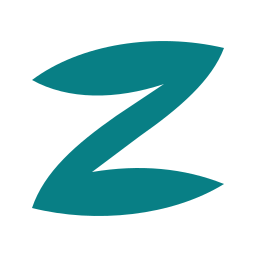

# Zefiro



Uma barra para Windows 11 feita para quem programa: **nativa (Rust, sem WebView)**, fluida e personalizável, com uma **ilha de mídia** no centro e chips de uso do Claude, do Codex e do Grok, projetos do VS Code e do Cursor, Spotify, terminal, chat com IA e mais.

[**Baixar a última versão**](https://github.com/Felipe-Cavalari/zefiro/releases/latest) · [Reportar um problema](https://github.com/Felipe-Cavalari/zefiro/issues/new/choose) · [Planejamento](docs/PLANNING.md)

> **Status: beta.** Uso diário do autor desde outubro de 2026, com 14 dias seguidos sem nenhum crash (contados de 22/10 a 4/11). Ainda é um projeto pessoal em evolução: espere arestas, e use o botão de diagnóstico (veja abaixo) para me contar o que quebrou.

## O que ele faz

- **Barra por monitor** que reserva espaço na tela (AppBar), em cinco formatos: faixa, pílulas, ilhas, Fluent e Vidro. Nove temas embutidos, acrílico opcional e temas seus em TOML.
- **Ilha de mídia** em Rust: mídia tocando (Spotify, YouTube, Twitch…), visualizador de áudio, avisos (volume, notificação, Bluetooth, Não perturbe), clima, hardware e letras com karaokê. Cor de destaque tirada da capa.
- **Animações com física de mola rodando no compositor do Windows**: abrir e fechar painéis não gasta CPU por quadro.
- **Modo de edição** ("Editar barra"): arraste os chips entre início, centro e fim, escolha o layout de cada monitor, ative "Ocultar automaticamente".
- **Chips** (cada um só roda se estiver na barra):

  | Grupo | Chips |
  | --- | --- |
  | Sistema | relógio e calendário, som, microfone, brilho (DDC/CI), notificações, Não perturbe, energia, bandeja do sistema |
  | IA | uso do Claude, do Codex e do Grok (`ia` junta os três em slides), chat com os três |
  | Desenvolvimento | projetos recentes do VS Code e do Cursor, perfis do Windows Terminal, comandos prontos para copiar |
  | Mídia e ilha | ilha, player, Spotify (busca, biblioteca, fila), clima, hardware |

- **WSL de primeira classe**: o uso do Claude e do Codex e o chat juntam as contas do Windows e das distros que estão rodando. O Zefiro nunca liga uma distro parada.
- **Leve:** não usa WebView nem Electron. Numa medição de 4/11/2026, com a barra completa e vários chips, o `zefiro.exe` usava cerca de **50 MB de memória privada (86 MB de working set)**, contra 106 MB / 176 MB do YASB na medição de referência de outubro (`docs/baseline.md`, configurações diferentes). Os números variam com os chips ligados.
- **Desinstalação limpa:** o instalador é por usuário, sem admin, e nunca apaga a sua configuração.

## Instalar

Requisito: **Windows 11** (testado na versão 26200). Não foi testado no Windows 10.

1. Baixe `Zefiro-<versão>-setup.exe` na [página de releases](https://github.com/Felipe-Cavalari/zefiro/releases/latest).
2. Execute. Não pede administrador; instala em `%LOCALAPPDATA%\Programs\Zefiro`. Há uma opção para iniciar junto com o Windows.

> [!NOTE]
> O instalador **ainda não é assinado digitalmente**, então o Windows SmartScreen pode mostrar "O Windows protegeu o computador". Clique em **Mais informações → Executar assim mesmo**. Se preferir não confiar num binário, o código é aberto e dá para [compilar você mesmo](#compilar).

**Atualizações:** o Zefiro consulta o GitHub Releases uma vez por dia e mostra "Atualizar para a x.y.z" no menu do Z. Nada é instalado sem você clicar.

**Desinstalar:** pelo "Aplicativos instalados" do Windows. A pasta `%APPDATA%\zefiro` (configuração e temas) e os logs ficam; apague à mão se quiser.

## Primeiros passos

- Clique no **Z** (ou com o botão direito na barra) para abrir o menu: temas, Editar barra, Configurações e Sair.
- **Editar barra** liga o modo de edição: arraste os chips, use **+** para adicionar e **Concluir** para salvar.
- Para fechar, use **Sair** no menu. Isso devolve o espaço da AppBar ao Windows.
- Se você usa o YASB, feche-o antes: os dois reservam o topo da tela.

## Configuração

A configuração fica em `%APPDATA%\zefiro\config.toml` (criada na primeira execução e recarregada ao salvar) e os seus temas em `%APPDATA%\zefiro\themes\`. Os logs ficam em `%LOCALAPPDATA%\zefiro\logs`.

```toml
[bar]
height = "compacta"      # completa | compacta
format = "ilhas"         # faixa | pilulas | ilhas | fluent | vidro
autohide = false
display = "todos"        # todos | principal

[bar.sections]
start  = ["zefiro", "terminal", "vscode"]
center = ["island"]
end    = ["ia", "audio", "brightness", "tray", "clock"]
```

Os ids disponíveis: `zefiro`, `clock`, `audio`, `mic`, `brightness`, `claude`, `codex`, `grok`, `ia`, `vscode`, `cursor`, `terminal`, `chat`, `notifications`, `dnd`, `island`, `player`, `weather`, `hardware`, `tray`, `spotify`, `commands`, `power`. A maioria das opções pode ser mudada pelo próprio modo de edição, sem abrir o arquivo.

## Uso do Claude, do Codex e do Grok

Os chips de uso juntam as contas do Windows e das distros do WSL que estão rodando (`wsl --list --running`), identificando quem é quem pelo e-mail ou UUID da conta em cada origem.

- O uso do Claude vem do comando `/usage` do próprio Claude Code (`claude -p /usage`), a cada 5 minutos. O Zefiro **não usa o token** da sua assinatura: quem lê o login, renova e fala com a Anthropic é o Claude Code. O comando não chama o modelo e não gasta nada da sua cota.
- Por isso o Claude Code precisa estar instalado em cada origem (Windows ou distro) com login. Sem ele, o painel diz "Claude Code não encontrado".
- Uma distro parada aparece como "WSL desligado": o Zefiro nunca lê `\\wsl.localhost\<distro>\...` de uma distro parada, porque isso a ligaria sozinho.
- O uso do Codex sai do fim dos arquivos de sessão em `~/.codex`, sem abrir credenciais.
- O uso do Grok vem do próprio Grok Build (`grok`), a cada 5 minutos: um `grok agent stdio` curto pede a cota da assinatura (`_x.ai/billing`) sem abrir conversa e sem chamar o modelo. É preciso ter o Grok Build instalado com `grok login` no Windows ou numa distro rodando.

## Avisos sobre as assinaturas

> [!WARNING]
> **Claude.** O Zefiro não é um produto da Anthropic. Os termos da Anthropic dizem que o login das assinaturas Free, Pro e Max só pode ser usado no Claude Code e no Claude.ai. O Zefiro nunca lê nem usa o seu token, mas dois recursos dependem do Claude Code que você instalou:
>
> - **Chip de uso do Claude:** roda o comando `/usage` do Claude Code. Ele não chama o modelo e não gasta nada da sua cota.
> - **Chat com o Claude:** roda o `claude -p` sem ferramentas, como um chat dentro da barra, e usa a sua cota como qualquer conversa no Claude Code.
>
> Rodar o `claude -p` por script é um uso documentado do Claude Code, mas os termos não dizem nada explícito sobre outro app usar o Claude Code como chat. É uma zona cinzenta, e a Anthropic mudou essas regras várias vezes em 2026. O risco fica com a sua conta: no pior caso, a Anthropic pode bloquear o acesso ou suspender a conta. Se você não quiser correr esse risco, deixe os chips `claude`, `ia` e `chat` fora da barra (modo de edição). Sem eles, o Zefiro não roda o Claude Code.

> [!WARNING]
> **Grok.** O Zefiro não é um produto da xAI. Ele nunca lê o login do Grok (`~/.grok/auth.json`) nem fala com a xAI por conta própria: os dois recursos abaixo rodam o Grok Build (`grok`) que você instalou e com o qual fez login.
>
> - **Chip de uso do Grok:** pede a cota da assinatura ao `grok` (`_x.ai/billing`). Não abre conversa, não chama o modelo e não gasta nada da sua cota.
> - **Chat com o Grok:** roda o `grok agent stdio` com um perfil que só libera a geração de imagens (sem ler arquivos, terminal ou web), como um chat dentro da barra. As imagens saem da mesma cota do Imagine. Com a assinatura (SuperGrok, X Premium+ ou X Subscription), cada pergunta sai da mesma cota semanal do grok.com, do Imagine e do Grok Build; com `XAI_API_KEY`, você paga por token. O Grok 4.7 Fast custa o dobro.
>
> Rodar o Grok Build por script ou pelo ACP é um uso documentado pela xAI, mas os termos não dizem nada explícito sobre outro app usar o Grok Build como chat com a assinatura. É uma zona cinzenta, e as regras dos planos da xAI mudaram duas vezes em 2026. O risco fica com a sua conta: no pior caso, a xAI pode limitar ou suspender o acesso. Se não quiser correr esse risco, deixe os chips `grok` e `ia` fora da barra e o chat no Claude ou no Codex.

Tudo que o Zefiro lê fica no seu PC: **não há telemetria**. As conversas do chat ficam só em `%LOCALAPPDATA%\zefiro\chat` e nunca vão para o log. O token do Spotify fica cifrado pelo DPAPI do Windows.

## Reportar um problema

1. No menu do Z, abra **Configurações → Exportar diagnóstico**. Ele grava em Downloads um `.zip` com logs, relatórios de crash e configuração, **sem tokens e sem caminhos pessoais**.
2. Abra uma [issue](https://github.com/Felipe-Cavalari/zefiro/issues/new/choose) e anexe o `.zip`. Confira o conteúdo antes de enviar, se quiser.
3. `Ctrl+Alt+Shift+D` abre o HUD de debug (quadros, memória e o último dado de cada integração).

Para vulnerabilidades de segurança, veja [`SECURITY.md`](SECURITY.md).

## Compilar

Requisitos: Rust (a versão vem de `rust-toolchain.toml`) e o Visual Studio Build Tools com C++.

```powershell
cargo build --release -p zefiro-app
./target/release/zefiro.exe
```

Para gerar o instalador: `pwsh -NoProfile -File scripts/package.ps1` (precisa do Inno Setup 6). Para testar sem mexer na sua configuração, aponte `ZEFIRO_CONFIG_DIR` para uma pasta vazia. Contribuições são bem-vindas: leia [`CONTRIBUTING.md`](CONTRIBUTING.md) e o [`AGENTS.md`](AGENTS.md).

## Roteiro

Feito: barra, modo de edição, ilha em Rust, áudio e brilho, chips de desenvolvimento e de IA, bandeja, Spotify, formatos e temas, atualização automática.

Próximo (detalhes em [`docs/PLANNING.md`](docs/PLANNING.md)): app de configurações pesquisável, **launcher** (busca em apps, arquivos, projetos e ações), itens declarativos e catálogo de temas da comunidade e, depois da 1.0, integração com o komorebi. A dock saiu do plano de propósito: o Zefiro complementa a barra de tarefas do Windows em vez de substituí-la ([motivo](docs/PLANNING.md)).

Decisões de arquitetura ficam em [`docs/adr/`](docs/adr/). A identidade visual está em [`assets/branding/`](assets/branding/README.md).

## Créditos e agradecimentos

O Zefiro nasceu de ideias, experiências de uso e trabalho compartilhado pela comunidade open source. Agradecemos aos autores, mantenedores e colaboradores de cada um destes projetos:

| Projeto | Contribuição para o Zefiro e agradecimento |
|---|---|
| [Seelen-UI](https://github.com/eythaann/Seelen-UI) | Inspiração para a proposta de um ambiente de desktop personalizável, com barra, dock, launcher, gerenciamento de janelas e recursos da comunidade. Obrigado por mostrar novas possibilidades para a experiência de desktop no Windows. A contribuição é conceitual e de experiência de uso, sem código copiado. |
| [Zebar](https://github.com/glzr-io/zebar) | Inspiração para providers reativos, pacotes de widgets e um futuro catálogo da comunidade. Obrigado por demonstrar como separar fontes de dados da apresentação e abrir espaço para a personalização. A contribuição é conceitual, sem código copiado. |
| [YASB](https://github.com/amnweb/yasb) | Referência prática para a barra e seus widgets, especialmente uso do Claude e do Codex, projetos do VS Code, brilho, Não perturbe e notificações. Obrigado pela variedade de integrações e pela experiência de personalização que ajudaram a definir as necessidades do Zefiro. |
| [PowerToys](https://github.com/microsoft/PowerToys) | Inspiração para o modo de edição da barra e para a fluidez da interação, em especial a Dock da Paleta de Comandos. Obrigado por explorar formas de tornar as ferramentas de produtividade do Windows mais acessíveis e configuráveis. A contribuição é conceitual, sem código copiado. |
| [EarTrumpet](https://github.com/File-New-Project/EarTrumpet) | Referência técnica para as interfaces internas de áudio do Windows usadas na seleção de dispositivos e no roteamento de áudio por aplicativo. Obrigado por compartilhar conhecimento sobre essas interfaces e facilitar integrações de áudio mais completas. |
| [Dynamic Island for Windows](https://github.com/devcode90/Dynamic-Island-for-Windows), de devcode90 | Inspiração para a ilha de mídia. Alguns trechos de lógica, como as molas e o visualizador, foram reescritos em Rust a partir dele e estão listados em [`THIRD_PARTY_NOTICES.md`](THIRD_PARTY_NOTICES.md). |

Nosso agradecimento também a todos que mantêm as bibliotecas Rust e as ferramentas utilizadas na construção do Zefiro. As dependências e suas versões estão registradas nos arquivos `Cargo.toml` do workspace e no [`Cargo.lock`](Cargo.lock).

Os avisos de licença e a identificação do código portado estão em [`THIRD_PARTY_NOTICES.md`](THIRD_PARTY_NOTICES.md). Cada projeto mantém sua própria licença e autoria.

## Licença

MIT OR Apache-2.0. Veja [`LICENSE-MIT`](LICENSE-MIT) e [`LICENSE-APACHE`](LICENSE-APACHE).
